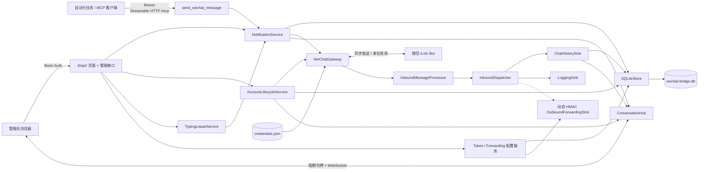
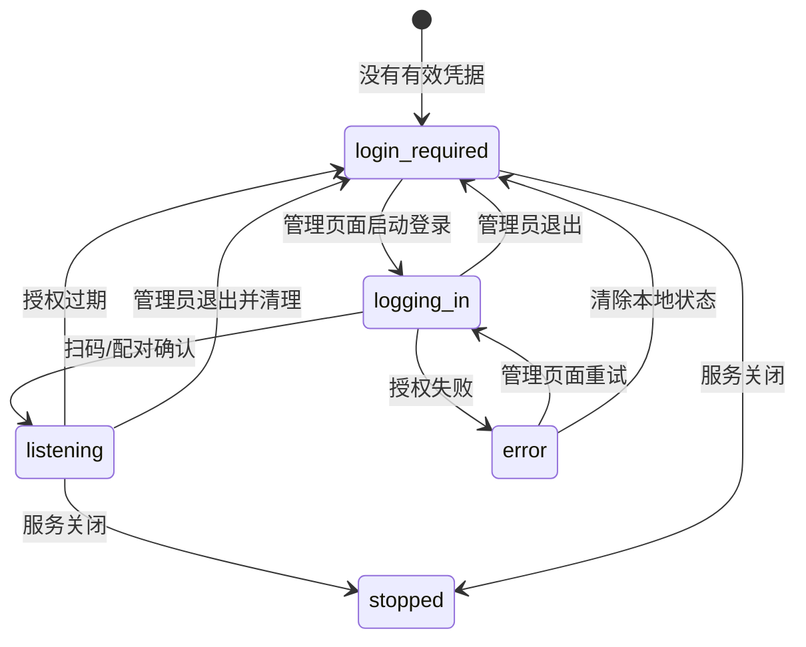
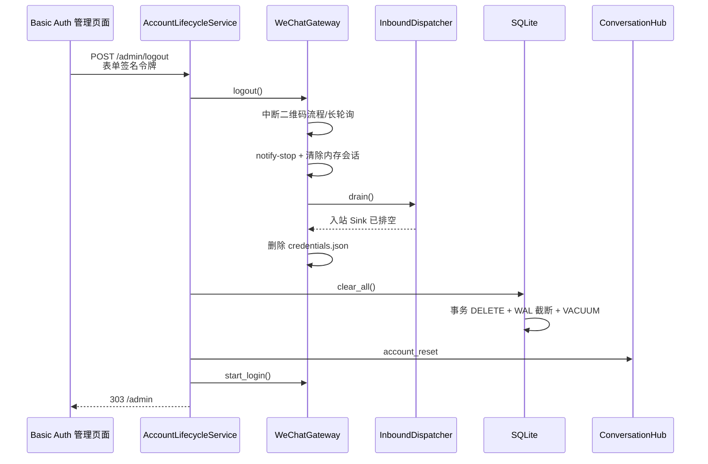
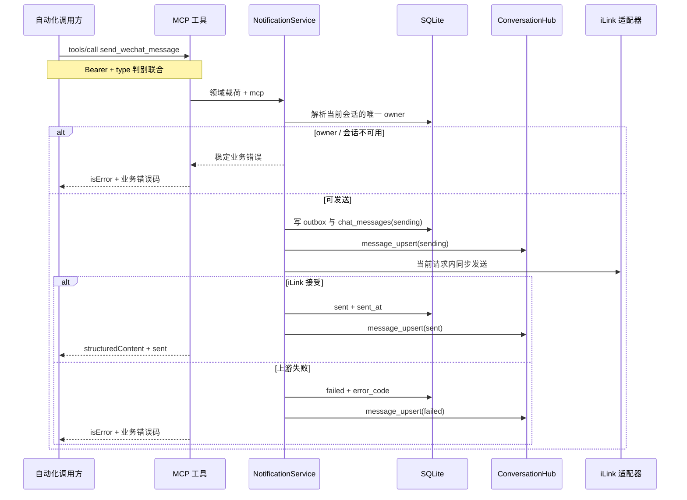
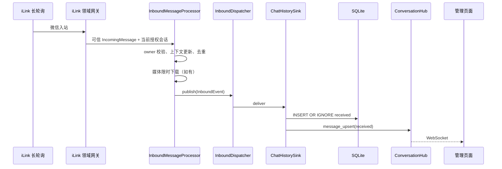

# 架构设计

## 1. 定位与边界

`wechat-bot-bridge` 把微信 iLink Bot 封装为单机桥接服务：

- 自动化任务只依赖一个 Bearer 认证的 MCP 工具；
- 管理员通过独立 Basic Auth 页面查看和发送完整聊天；
- 单一长轮询消费者接收入站消息；
- SQLite 是聊天历史和会话上下文的恢复依据；
- WebSocket 只承担低延迟页面更新，不代替持久化。

它不是桌面个人微信 Hook。当前通道只表示扫码账号与 Bot 的一对一私聊，不提供联系人抓取、任意目标发送、普通微信群监听、出站 exactly-once 或多副本高可用。

## 2. 目录与依赖

```text
src/wechat_bot_bridge/
├── api/                        MCP 工具、Bearer、健康检查、共享载荷 schema
├── application/                账号生命周期、发送编排、服务配置、载荷校验、输入租约
├── bootstrap/                  FastAPI/CLI 装配、单实例锁与生命周期
├── core/                       WBB_* 配置、源码/冻结程序路径策略
├── domain/                     模型、错误、端口
├── infrastructure/
│   ├── inbound/                Dispatcher、ChatHistorySink、OutboundForwardingSink
│   ├── persistence/            SQLite 事务、schema/迁移、行映射、历史游标
│   ├── realtime/               进程内会话广播
│   └── wechat/
│       ├── gateway.py          授权与监听生命周期、领域错误映射
│       ├── inbound.py          owner 校验、规范化、去重与媒体
│       ├── delivery.py         出站领域载荷映射
│       ├── protocols.py        网关依赖契约
│       ├── session.py          授权会话指纹
│       └── ilink/              内置协议客户端、授权、HTTP、消息和 CDN
└── web/
    ├── router.py               管理路由装配
    ├── routes/                 页面、账号、消息、服务配置、WebSocket
    ├── schemas.py
    ├── security.py
    ├── templates/              Jinja2 服务端页面
    └── static/                 同源 CSS/JavaScript
```

依赖方向：

```text
api/web/bootstrap -> application -> domain ports <- infrastructure adapters
```

- `domain/` 不导入 FastAPI、SQLite、HTTP 客户端或 iLink wire 模型。
- `api/` 只处理外部认证、schema 和错误映射。
- `web/` 是单独的同源管理边界，不把管理数据塞回外部 API。
- `web/router.py` 只负责装配；`web/routes/` 按页面、账号、消息和实时协议拆分。
- `application/` 编排唯一 owner、同步发送、状态迁移和实时发布。
- `application/payloads.py` 保存可独立测试的纯规则，发送用例只负责顺序和失败补偿。
- `bootstrap/` 是具体组件装配的唯一位置。
- `infrastructure/persistence/` 将 schema/迁移、行映射、游标和事务编排分离，避免数据库兼容逻辑污染业务存取方法。
- `infrastructure/wechat/ilink/` 是唯一接触 iLink 原始 JSON、认证头和 CDN 加密的位置。
- `infrastructure/wechat/gateway.py` 只维护生命周期和错误边界；入站、出站及会话纯规则由同目录专用模块承担，不解析 HTTP 字典。
- 入站扩展通过 `InboundSink`，不在长轮询循环中硬编码页面或业务下游。

包目录使用隐式命名空间，不需要占位 `__init__.py`。

## 3. 组件关系



## 4. 管理端授权与退出

网关任务始终由 FastAPI lifespan 持有，但没有授权文件时只进入 `login_required` 并等待控制事件，不会自行申请二维码或向容器终端输出敏感链接。受 Basic Auth 保护的页面通过应用服务触发登录，网关在内存中保存当前二维码 URL，Web 路由只把它编码成 `no-store` SVG 图片。扫码后的配对数字也通过管理接口交给正在等待的授权协程；二维码 URL 和配对数字都不会持久化。



退出是一个跨组件的破坏性事务流程，应用层与普通发送共用账号操作锁：



先停生产者、再排空消费者、最后清库是关键顺序：否则退出前已经收到的消息可能在清空后重新落库。`ConversationHub` 广播重置前会清空各订阅队列；页面使用账号世代号忽略仍在途的清理前历史响应。

## 5. 外部同步发送



应用服务使用异步锁串行化唯一账号的出站动作，避免媒体上传和消息项交叉；同一把锁也覆盖账号退出与清理。服务不做后台出站重试。

每次独立发送都生成新的 UUID。文字、图片和文件同步成功响应还会返回微信
`sendmessage.message_id`，外部字段名为 `msg_id`；原始值不持久化，SQLite
只保存账号隔离哈希。输入状态没有微信聊天消息，因此 `msg_id=null`。JSON-RPC ID
只关联协议响应。若响应丢失，再次调用工具可能重复通知。

FastAPI lifespan 启停官方 SDK 的无状态 Streamable HTTP 会话管理器。请求进入协议层前，
先用服务配置中的 Token 鉴权。SDK 校验 Host、Origin 和请求体大小。外部调用方先通过
`tools/list` 获取工具 schema，再用 `tools/call` 提交带判别字段的 `message`。完整聊天
记录和微信状态由管理页单独鉴权，`/openapi.json` 的 `paths` 为空。

### 出站类型

- `text` -> 按 4000 字符自然边界切片后调用 `sendmessage`；
- `image` -> `getuploadurl`、AES/CDN 上传、可选说明文字、图片 `sendmessage`；
- `file` -> `getuploadurl`、AES/CDN 上传、可选说明文字、文件 `sendmessage`；
- `typing_start` / `typing_cancel` -> `getconfig` 取得 ticket 后调用 `sendtyping`。

媒体经标准 Base64 解码，默认上限 20 MiB、绝对上限 25 MiB。MCP 工具和
管理页面不开放原生语音、视频或 Bot 出站引用；`ref_msg` 只进入微信入站
解析链路。

## 6. 微信入站与 Sink

单次 `getupdates` 批次的处理顺序：

1. `messages.py` 把 wire 字典解析为不含原始载荷的 `IncomingMessage`；
2. 确认入站 `user_id` 与扫码凭据账号完全一致；
3. 保存唯一 owner 的最新 `context_token`；
4. 规范化正文与原生 `QuotedMessage`，形成版本化 `InboundEvent`；
5. 使用 `account_id + upstream_id` 生成稳定事件 ID 并持久去重；
6. 对非文字消息从 CDN 流式读取密文，在上限内使用 AES-128-ECB 解密；
7. 把仅供进程内聊天 Sink 使用的媒体附加到事件，再放入 `InboundDispatcher`；
8. 整批处理成功后持久化新的 `get_updates_buf`。

媒体字段在 Pydantic 模型中显式排除序列化，因此 `inbound_events.payload_json`、LoggingSink 和单向转发信封都不会包含媒体字节。解析器不生成 `[image]`、`[voice]` 等占位符，也不把图片 URL 拼入正文；iLink 媒体占位符会被过滤。下载失败、超时或超过上限时仍转发原始消息类型，不阻断消息历史。解析后的微信原生引用标题、类型和正文快照进入规范化转发事件。

Dispatcher 顺序调用：

1. `ChatHistorySink`：写入 `chat_messages`，再向 `ConversationHub` 广播；
2. `LoggingSink`：只记录事件 ID 和类型等脱敏元数据；
3. `OutboundForwardingSink`：配置启用时读取当前快照，执行 HMAC 签名、短超时和有限重试。



单向转发使用有界进程内队列和有限重试，不提供重启续投；需要强可靠消费时，
下游必须先持久化事件并按 `event_id` 去重。

## 7. 管理 Web

管理端采用非前后端分离结构：

- Jinja2 返回 HTML 外壳和短期页面令牌；
- 同仓库静态 CSS/JavaScript 渲染对话并调用同源管理接口；
- 无 Node.js 构建链或单独前端服务；
- Basic Auth 保护页面、历史、媒体、状态与发送；
- 写操作额外要求 `X-Admin-Token`；WebSocket 通过子协议头携带同一签名机制的令牌，避免令牌进入 URL 和访问日志。
- 页面负责首次扫码、二维码刷新和可选配对数字输入；二维码图片接口不会暴露上游原始 URL。
- 退出使用 Basic Auth 下的原生 URL 编码表单，并校验隐藏的短期页面令牌；成功清除后重定向回登录视图。
- 输入框键入使用 `TypingLeaseService`；浏览器刷新防抖定时器，服务端租约到期后兜底取消微信输入状态。
- 微信入站原生引用以只读快照展示；引用 item ID 精确匹配到已保存历史的顶层 message ID 或 item ID 时，引用框可点击定位原文并让目标气泡闪高两次。页面不提供右键引用或 Bot 出站引用。
- 左侧服务配置菜单通过 `configuration.py` 管理自动生成的MCP Token 和单向转发参数；读取 Secret 的响应使用 `no-store`，写操作复用现有短期页面令牌，登录后不重复询问密码。

Basic 密码与外部 Bearer Token 不得复用。源码和 Docker 部署缺少 `WBB_WEB_PASSWORD` 时管理端关闭。
Windows 首次启动会在用户配置中生成随机管理密码。HTML 使用 `no-store`、严格 CSP 和禁止 framing；媒体启用 `nosniff` 与沙箱 CSP。

页面先建立 WebSocket，再在网关进入 `listening` 后加载 SQLite 历史并按 ID upsert，可覆盖“订阅与初次加载之间”的竞态。断线后自动重连；进程总线对慢订阅者丢弃最旧事件，因此历史接口始终是恢复依据。收到 `account_reset` 后页面立即清空内存消息、附件、原生引用快照和游标，并切换到扫码视图。

管理历史从最新一页向前使用 `(occurred_at, id)` 不透明游标，页内按时间正序。响应包含完整文字、受保护媒体 URL、方向、来源、状态和微信入站原生引用快照；引用目标经官方协议 ID 精确匹配时额外返回管理端消息 ID，但不包含原始顶层 message ID、item ID、owner ID、上下文或凭据。

## 8. SQLite

Docker 持久化布局：

```text
/data/
├── wechat-bridge.db
└── wechat/
    └── credentials.json
```

Windows 单文件 EXE 的默认持久化布局：

```text
%LOCALAPPDATA%\wechat-bot-bridge\
├── config\settings.json
├── wechat-bridge.db
├── wechat-bot-bridge.lock
├── wechat-bot-bridge.log
└── wechat\
    └── credentials.json
```

`wechat-bot-bridge.lock` 是部署级非阻塞文件锁。锁只标识当前数据目录是否已被活动进程占用，
不保存消息、凭据或用户标识；异常退出后操作系统自动释放锁，文件本身可以保留。

主要表：

- `bridge_state`：当前授权 fingerprint 和 cursor 等状态；
- `recipients`：保存 `alias=owner` 的唯一会话上下文；
- `inbound_events`：入站事件去重；
- `outbound_messages`：同步出站审计；
- `chat_messages`：管理页面完整会话内容、媒体、方向、来源、状态，以及微信原生引用快照。
- `service_settings`：MCP Token 和单向转发配置；不属于微信账号业务数据。

文字直接保存在 `chat_messages.text`。页面发送以及内置客户端下载成功的微信入站图片和文件保存在 BLOB，并通过 Basic 保护的媒体接口读取；图片以内容签名判断安全 MIME，未知内容使用 `application/octet-stream`，SVG 等未识别内容不会作为可内嵌图片提供。微信入站消息的官方 `MessageItem.msg_id` 和顶层 `WeixinMessage.message_id` 分别与账号 ID 一起哈希后保存在内部 `protocol_item_id`、`protocol_message_id`，不落原始值。Bot 出站主项固定使用本地消息 UUID 作为顶层 `client_id`，传输层解析线上 `sendmessage` 成功响应的整数 `message_id`；该值与微信引用中的 `MessageItem.msg_id` 相同，成功投递后按同样规则哈希写入对应出站记录。引用保存 `native_quote_title/type/text`、内部 `native_quote_protocol_item_id` 和精确目标；SQLite 用引用键匹配原消息的任一协议键并回填上游缺失的正文，不使用正文或时间猜测。

出站记录先为 `sending`，再变为 `sent` 或 `failed`。进程重启会把未完成的
发送标记为 `delivery_interrupted`，不会自动重发。授权会话变化会让进行中的
发送变为 `interaction_required` 并清除 owner 上下文。

退出调用 `clear_all()`，在一个 `BEGIN IMMEDIATE` 事务中删除五张账号业务表。`service_settings` 明确排除在清理集合之外，因此 Token 和转发配置保持有效。连接启用 `secure_delete`，提交后截断 WAL 并执行 `VACUUM`；数据库文件和目录保留，以便同一进程马上建立新授权。授权文件由网关在 SQLite 清理之前单独删除。

## 9. 生命周期与并发

- 单进程、一个 Uvicorn worker、一个 iLink 长轮询所有者。
- CLI 和 Windows 托盘入口在打开 SQLite 前持有数据目录文件锁；第二个进程立即失败，不依赖端口冲突作为并发保护。
- FastAPI lifespan 依次管理 SQLite、Dispatcher、Gateway task，并在关闭时停止和等待。
- 无凭据时 Gateway task 常驻等待管理端登录事件；有有效凭据时直接启动监听。
- 管理端输入租约任务也属于 lifespan；关闭前尽力取消仍处于活动状态的微信输入提示。
- SQLite 共享连接通过异步锁串行。
- 出站发送和账号退出通过同一个应用服务异步锁串行。
- 退出长轮询后调用 Dispatcher `drain()`，确保队列清空后才删除 SQLite 数据。
- ConversationHub 是进程内实时优化，不尝试跨进程协调。
- 未实现 poller 租约、共享队列和并发存储前，不允许多 worker 或多副本。

## 10. 安全模型

信任边界：

1. MCP 客户端 -> `/mcp`：管理页面生成的 Bearer Token；
2. 管理浏览器 -> `/admin`：独立 Basic Auth；
3. 已认证页面 -> 写操作、退出表单/WebSocket：短期 HMAC 页面令牌；
4. 服务 -> iLink：宿主机映射的明文授权文件；
5. 服务 -> 单向转发目标：独立 HMAC Secret。

公共 Token、Basic 密码、转发 HMAC Secret、iLink token、二维码原始 URL、配对数字和 `context_token` 不得进入 Git、日志或普通业务响应。完整公共 Token 和转发 Secret 仅能通过 Basic Auth 保护且 `no-store` 的专用管理响应读取。二维码只作为同样受保护的 `no-store` SVG 图片返回。管理页有意展示聊天正文和媒体，因此只应通过 HTTPS/私网访问。健康接口只返回最小状态。

CLI 通过 `core/logging.py` 安装统一处理器。业务模块可以用 `extra` 提交上下文，
但格式化器只输出审核过的消息 ID、事件 ID、类型、状态、错误码、HTTP 状态和
重试字段；任意未列入白名单的字段都会被丢弃。转发重试异常不会保留可能
包含目标 URL 的异常链。

## 11. 内置 iLink 客户端与扩展

项目不依赖第三方微信 SDK。`infrastructure/wechat/ilink/` 的职责如下：

- `auth.py`：以 camelCase 格式原子读写敏感授权文件，并处理扫码、配对码、二维码刷新和 IDC 跳转；
- `transport.py`：复用 `httpx.AsyncClient`，生成 iLink 认证头，分别设置普通请求、配置请求和长轮询超时，只把操作名、HTTP 状态和数值错误码暴露给上层；
- `messages.py`：构造 `sendmessage` wire 对象，解析用户消息、媒体和一层入站原生引用，不让原始字典进入领域；
- `crypto.py` / `media.py`：支持直接 hex、Base64(raw) 和 Base64(hex) 三种 AES key 表示，负责 CDN 加解密、有限上传重试和流式下载上限；
- `client.py`：组合文字、图片、文件、输入状态和更新批次；
- `gateway.py`：维护管理端驱动的授权状态机、唯一会话、cursor 和领域错误边界；
- `inbound.py`：校验扫码 owner、更新上下文、事件去重、正文规范化和受限媒体下载；
- `delivery.py`：把领域载荷穷举映射到高层客户端调用；
- `protocols.py` / `session.py`：隔离可测试客户端契约与授权指纹规则。

`context_token` 由 SQLite owner 记录传给每次发送。`get_updates_buf` 在整批
处理成功后持久化；崩溃重放由 `event_id` 去重。授权 fingerprint 改变时，
存储层清空 owner，必须等待新扫码账号再次发消息。

iLink 当前只提供 Bot 向微信发送或取消输入状态的 `sendtyping`；`getupdates` 没有微信用户输入状态事件，因此网页到微信是单向同步。协议依据、端点和升级审计见 [iLink 协议实现说明](ilink-protocol.md)。

新增入站下游应实现 `InboundSink`；新增实时消费者应依赖
`ConversationPublisher`；新增出站类型必须同时更新领域模型、外部 schema、
iLink wire 构造、SQLite、页面呈现、测试和文档。当前 iLink 渠道不暴露
联系人列表；多用户渠道必须使用独立的目标解析模型。

## 12. 冻结发布边界

Windows 发布使用 PyInstaller one-file 的 GUI 子系统。双击 `packaging/windows_entry.py` 对应的
EXE 会取得部署锁，主线程运行 Win32 托盘消息循环，服务线程运行唯一的 Uvicorn。托盘退出
请求设置 `server.should_exit`，等待 lifespan 排空并关闭数据库后再释放锁。Explorer 重启时
会重新注册图标。桌面日志轮换写入数据目录。spec 明确收集：

- `wechat_bot_bridge/web/templates` 与 `web/static`；
- 多尺寸 `packaging/bridge.ico` 作为 EXE 图标资源，托盘直接加载同一资源中的小图标；
- 项目 dist-info，保证 `importlib.metadata.version()` 可用；
- Uvicorn 动态选择的 HTTP、WebSocket、事件循环和 lifespan 子模块；
- Python 解释器、Cryptography、SQLite 与其他锁定依赖。

PyInstaller 解包目录只保存只读代码和动态库。源码开发从工作目录读取 `.env`，Compose 从宿主机
注入环境变量。Windows 桌面入口只从 `%LOCALAPPDATA%\wechat-bot-bridge\config\settings.json`
加载 `WBB_*` 应用配置并复用同一套校验。文件缺失时生成随机管理密码，先写完整的临时文件，
再原子发布。并发启动采用先成功写入的配置。已有文件无效时报告错误，保留其内容。
默认可写数据仍位于 `%LOCALAPPDATA%\wechat-bot-bridge`，自定义数据位置不改变配置文件位置。
模板按包内 `__file__` 定位。发布包不得包含用户配置、`.env`、数据库、微信授权、聊天正文或真实 Token。

Windows EXE 必须在 Windows 上构建。`scripts/build-windows.ps1` 使用独立 uv 环境执行全部质量
门禁和 PyInstaller；`scripts/test-windows-release.ps1` 以临时数据目录启动真实单文件 EXE，
验证无参数 GUI 启动、Windows 通知区注册、托盘退出、MCP 握手与工具调用、OpenAPI、
Basic 管理页面、静态资源、SQLite 路径与单实例锁。
